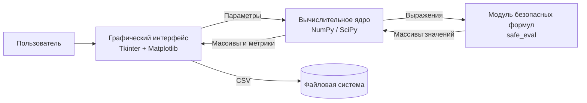

# Архитектура antenna_linear

Описание по модели C4.

## C1. Контекст системы

**Пользователь** (инженер, студент) задаёт параметры линейной антенны и получает характеристики её излучения.
**antenna_linear** — настольное приложение, которое решает прямую и обратную задачи для линейной апертуры.
**Файловая система** — место, куда пользователь сохраняет результаты в формате CSV.

## C2. Контейнеры

Приложение запускается как один процесс Python и состоит из трёх логических контейнеров.

| Контейнер | Технология | Назначение |
|---|---|---|
| Графический интерфейс | Tkinter, Matplotlib (TkAgg) | Ввод параметров, вкладки, графики, вывод метрик, сохранение файлов |
| Вычислительное ядро | Python, NumPy, SciPy (необязательно) | Расчёт АФР, ДН, метрик и синтез по методу наименьших квадратов |
| Модуль безопасных формул | Python (`eval` с ограниченным окружением) | Вычисление пользовательских выражений |

Внешних сервисов и базы данных нет: данные существуют только на время сеанса, а результаты сохраняются в CSV по запросу.

## Состав кода

| Элемент | Контейнер | Назначение |
|---|---|---|
| `AntennaApp` | Интерфейс | Главное окно, две вкладки, обработчики кнопок, построение графиков, экспорт CSV |
| `compute_direct` | Ядро | Прямая задача: АФР, ДН, ширина лепестка, уровень боковых лепестков |
| `compute_inverse` | Ядро | Обратная задача: синтез АФР по требуемой ДН (`numpy.linalg.lstsq`) |
| `amplitude_distribution` | Ядро | Равномерное, косинусное и гауссово амплитудные распределения |
| `phase_distribution` | Ядро | Нулевое и линейное фазовые распределения |
| `safe_eval` | Формулы | Вычисление выражений с ограниченным набором имён |

## Потоки данных

**Прямая задача**

1. Интерфейс считывает параметры и проверяет их (`N ≥ 2`, `M ≥ 3`).
2. `compute_direct` формирует сетку `x`, амплитуду и фазу. Для пользовательских формул вызывается `safe_eval`.
3. ДН считается как дискретная сумма по апертуре: `F(θ) = Σ A(x)·exp(j·(φ(x) + k·x·sin θ))·dx`.
4. Результат нормируется и переводится в дБ, затем считаются характеристики.
5. Интерфейс строит графики, показывает метрики и запоминает результат для экспорта.

**Обратная задача**

1. Формируется требуемая ДН (`|cos θ|^n`, гауссова или формула) и нормируется.
2. Строится матрица `A[i, j] = exp(j·k·x_j·sin θ_i)·dx`.
3. Решается система `A·F = D` методом наименьших квадратов, откуда берутся амплитуда и фаза АФР.
4. Вычисляется синтезированная ДН и ошибка RMS между ней и требуемой ДН.

## Особенности и ограничения

- Если Tkinter недоступен (режим без дисплея), Matplotlib переключается на бэкенд `Agg`, но окно приложения в этом режиме не работает.
- `safe_eval` запрещает встроенные функции Python, но это не полноценная песочница, поэтому формулы нужно вводить только из доверенных источников.
- В обратной задаче целевое поле считается с нулевой фазой, поэтому решение приближённое.
